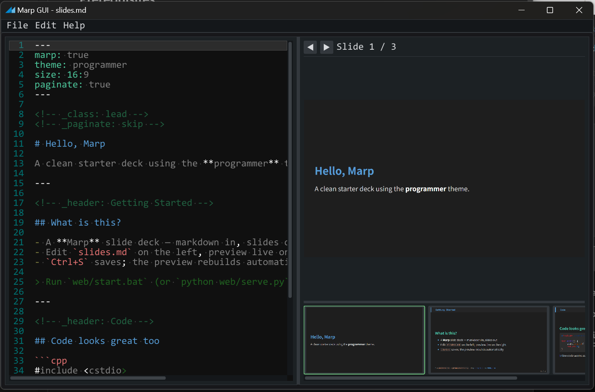

# marp-gui

Native [Marp](https://marp.app) slide editor for Windows and macOS, with live preview.



## Requirements

Node.js/npm, CMake ≥ 3.24, Chrome or Edge, and a C++17 compiler
(MSVC on Windows; Xcode Command Line Tools on macOS).

## Build and run

Use the same commands on either platform:

```sh
npm install --no-save --package-lock=false @marp-team/marp-cli
cmake -S gui -B gui/build -DCMAKE_BUILD_TYPE=Release
cmake --build gui/build --config Release --parallel
cmake --build gui/build --config Release --target run
ctest --test-dir gui/build -C Release --output-on-failure
cmake --install gui/build --config Release
```

CMake fetches the C++ dependencies. `run` opens `slides.md`; use File → Open
for another deck. Tests need an interactive desktop and the browser.
Install creates `gui/build/dist/marp-gui-{macos,windows}.zip`, containing
the `.app` or just the `.exe`. Node/Marp and the browser remain required.

Use **Cmd** on macOS or **Ctrl** on Windows: **S** saves, **O** opens,
**P** opens commands, **Z** undoes, and **Shift+Z** redoes.
File → Export produces PDF, PPTX, or HTML beside the deck.
The export dialog shows progress, then success or failure and the full output
path. **Open containing folder** opens the result's folder. **Run in background**
lets you keep editing; the dialog returns when the export finishes.

File → Open Recent and the command palette show the five most recently
opened decks. The list persists across restarts; **Clear Recent** clears it.
Turn off **Settings → Save recent file list** to clear the list and stop
recording file history. This preference persists across restarts.
Hold **Up** or **Down** in the command palette to move through results.

**Settings → Editor Color Scheme** offers Programmer, Dark, Light, and Retro
Blue palettes for the editor. Changes apply immediately and persist across
restarts. **UI Theme** controls the application menus and panels separately.

**Tab** inserts spaces to the next four-column tab stop by default. Disable
**Settings → Use spaces for tabs** to insert literal tabs. **Shift+Tab**
unindents the current line or selected lines; **Shift+Backspace** and
**Ctrl+Backspace** delete the preceding word.
**Ctrl+Left/Right** move by word or punctuation group, stopping at line breaks.
Hold **Shift** as well to select exactly the text traversed.

The test executable also supports `--perf`, using Dear ImGui Test Engine's
performance capture and CSV format:

```sh
gui/build/Release/marp_gui_tests --perf --test-deck slides.md
```

Use `gui/build/marp_gui_tests` with a single-configuration generator. Results
append to `marp_gui_perf.csv` in the current directory; set `MARP_GUI_PERF_CSV`
to choose another output file. Benchmarks measure total frame time with vsync
disabled, for the supplied deck and a 10,000-line Chinese/English document,
including committed Chinese input and a long line of unfinished links. Preview
builds are disabled during these editor benchmarks. Tests use a temporary deck copy.
Use `--test-filter substring` to run matching test names or categories.

Markdown highlighting uses a native scanner directly on the editor's glyph
buffer, with no text copies, regex, or identifier-table lookups. Plain Chinese
text is scanned in runs, and unfinished link searches take linear time.

On Windows, focused text input pumps native IME messages between display
frames while drawing at the monitor's refresh rate.

## Thanks

[Dear ImGui](https://github.com/ocornut/imgui),
[Test Engine](https://github.com/ocornut/imgui_test_engine),
[Marp CLI](https://github.com/marp-team/marp-cli), and
[TheAncientOwl’s themes](https://github.com/ocornut/imgui/issues/707).
Claude Code + Kimi K3.
